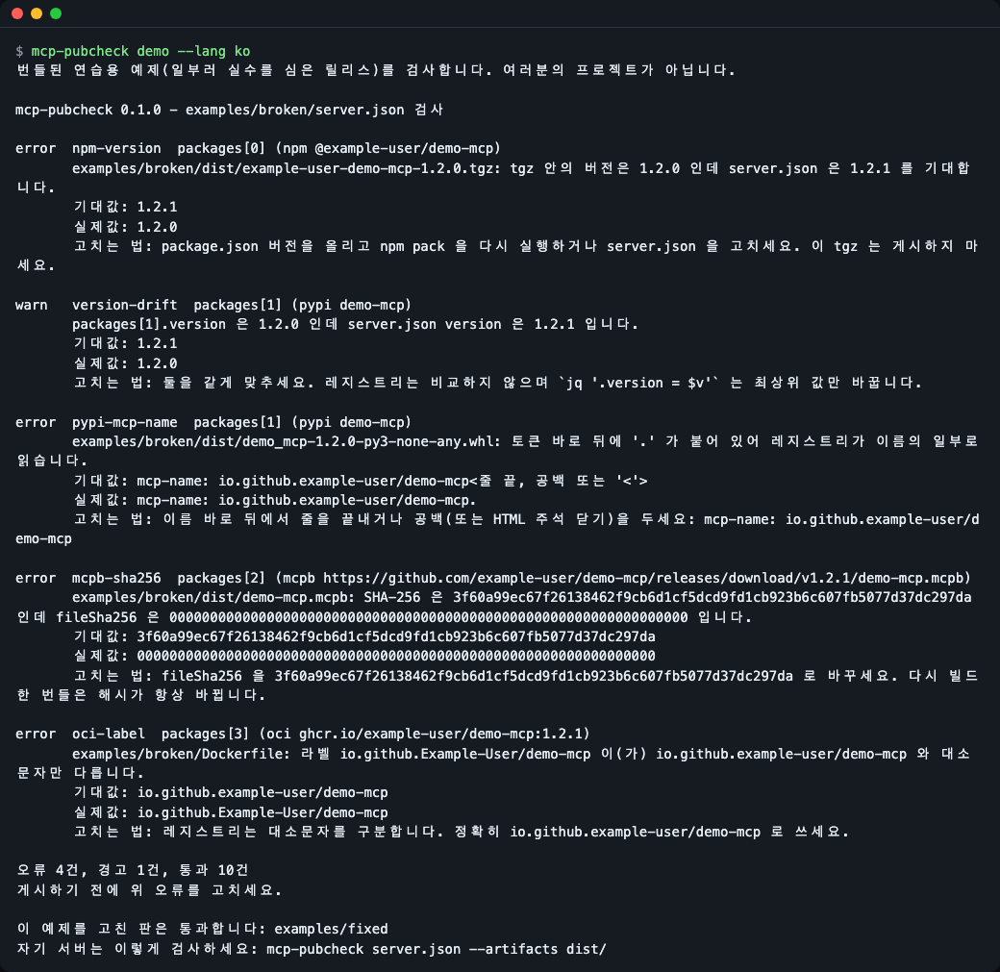
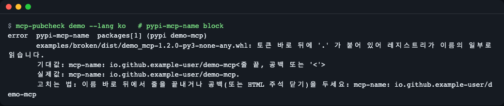
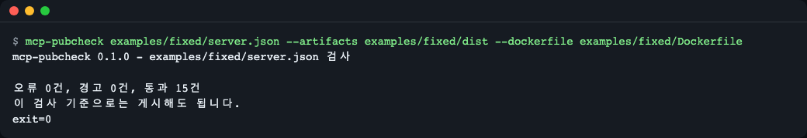
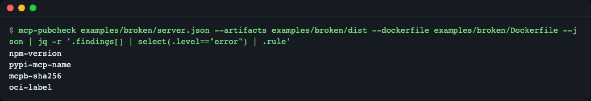
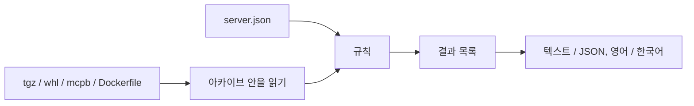

# mcp-pubcheck

[English](README.md) | **한국어**

MCP 서버를 게시하기 **전에**, 빌드된 패키지(npm 타르볼, PyPI wheel, MCPB 번들, Docker 라벨)를 `server.json` 과 대조해 봅니다. 오프라인, 명령 한 줄입니다. `mcp-publisher` 를 대체하지 않고 그 앞단의 관문이며, 소스 트리가 아니라 곧 올릴 파일을 직접 엽니다.


*번들된 연습용 예제: 일부러 실수를 심은 릴리스입니다. 각 항목에 규칙 ID·기대값·실제값·고치는 법이 나옵니다.*

## 이런 분께
- MCP 서버를 npm·PyPI·GHCR 또는 `.mcpb` 로 배포하고 공식 MCP 레지스트리에 등록하는 분
- CI 에서 `npm publish` 다음 `mcp-publisher publish` 를 돌리는데, 메타데이터 오타 하나로 버전 번호를 날리고 싶지 않은 분
- `jq '.version = $v'` 같은 스크립트로 버전을 올리고, 모든 곳이 바뀌었는지 확인하고 싶은 분

## 왜 필요한가
npm·PyPI 버전은 재사용할 수 없습니다. 레지스트리는 소유권 표시(`mcpName`, `mcp-name:`, 이미지 라벨)를 패키지가 이미 게시된 **뒤에** 확인하므로, 오타 하나가 새 버전 번호로 돌아옵니다. 상자를 봉하기 *전에* 송장과 내용물을 대조하는 것과 같습니다. 출처: [게시 안내](https://modelcontextprotocol.io/registry/quickstart), [registry#1525](https://github.com/modelcontextprotocol/registry/issues/1525) (2026-11-17 확인).

## 설치

Node.js 20 이상이 필요합니다(`brew install node` 또는 <https://nodejs.org>). 최소 리눅스 이미지에는 `git` 과 `nodejs`/`npm` 도 설치하세요. `jq` 는 선택입니다(`--json` 예시에만 필요).

```bash
git clone https://github.com/LeeGyeongPil/mcp-pubcheck
cd mcp-pubcheck
npm ci
```

npm 에 올라간 뒤에는 클론 없이 `npx mcp-pubcheck …` (또는 `npm install -D mcp-pubcheck`)로 실행할 수 있습니다.

## 빠르게 시작하기

번들된 연습용 예제(실제 `npm pack`·`uv build` 산출물에 실수 4개를 심은 것)를 검사합니다.

```bash
npm start
```

프로젝트를 빌드한 뒤 `examples/broken/` 을 검사합니다. 출력은 위 스크린샷과 같고, 끝부분은 다음과 같습니다(영어 환경 출력).

```text
4 errors, 1 warning, 10 checks passed
Fix the errors above before you publish.

The corrected version of this example passes: examples/fixed
Check your own server with: mcp-pubcheck server.json --artifacts dist/
```

`demo` 는 연습이라 항상 종료 코드 0 입니다. 내 서버를 검사하려면 서버 프로젝트 폴더에서 실행하세요(이 clone 의 `dist/cli.js` 전체 경로를 쓰거나, npm 릴리스 뒤에는 `npx mcp-pubcheck`).

```bash
node /path/to/mcp-pubcheck/dist/cli.js server.json --artifacts dist/
```

연습용 예제로 단계별 따라 하기:

1. **항목 읽기.** `npm-version` 은 타르볼 안 버전이 1.2.0 인데 `server.json` 은 1.2.1 을 기대한다는 뜻입니다. 옛 버전으로 만든 타르볼이 그대로 게시되어 거부될 뻔했습니다.
2. **점 하나가 왜 문제인지 보기.** 레지스트리는 `mcp-name: io.github.example-user/demo-mcp.` 를 마침표로 끝나는 이름으로 읽습니다.

   
   *기대값과 실제값이 나란히 나오고, 정확한 수정 방법이 함께 나옵니다.*
3. **고치고 다시 실행.** 고친 사본은 통과하고 종료 코드 0 입니다.

   ```bash
   node dist/cli.js examples/fixed/server.json --artifacts examples/fixed/dist --dockerfile examples/fixed/Dockerfile
   ```

   
   *"이 검사들이 아는 범위에서는 게시해도 안전합니다." — 사전 점검이지 보증이 아닙니다.*

## 검사 항목

| 대상 | 규칙 ID | 내용 |
|---|---|---|
| `server.json` | `schema`, `typo-key`, `version-range`, `forbidden-field`, `registry-base-url`, `meta-keys`, `meta-size`, `namespace-owner` | 번들 스키마(2025-12-11)와 스키마가 못 잡는 것: `registry_type` 오타, `latest`/`^1.2`, 유형별 금지 필드, 저장소 소유자와 네임스페이스 |
| 버전 드리프트 | `version-drift` | 최상위 `version` 과 각 `packages[].version` 이 같은지. 레지스트리는 비교하지 않습니다 |
| npm `.tgz` | `npm-identifier`, `npm-version`, `npm-mcp-name` | 타르볼 **안의** `package/package.json` |
| PyPI `.whl` / sdist | `pypi-name`, `pypi-version`, `sdist-version`, `pypi-mcp-name` | `METADATA`, `mcp-name:` 경계 규칙, 메타데이터에 README 없음 |
| `.mcpb` | `mcpb-sha256`, `mcpb-url`, `mcpb-manifest` | SHA-256 과 `fileSha256` 대조(맞는 해시를 출력). 레지스트리는 검사하지 않습니다 |
| OCI | `oci-label`, `oci-tag` | `Dockerfile` 의 `LABEL` 또는 `docker inspect` JSON |

모든 규칙·수준·고치는 법: [docs/rules.md](docs/rules.md).

## 사용법

| 옵션 | 하는 일 |
|---|---|
| `[server.json]` | 검사할 파일(기본 `./server.json`) |
| `--artifacts <폴더\|파일>` | 빌드된 패키지(여러 번 가능): `.tgz`, `.whl`, `.tar.gz`, `.mcpb`, `Dockerfile` |
| `--npm` `--wheel` `--sdist` `--mcpb` `--dockerfile` `--oci-inspect` | 파일을 하나씩 직접 지정(`docker inspect IMG > inspect.json`) |
| `--repo-url <url>` | 네임스페이스 검사용 저장소 URL(기본: `server.json`, 없으면 `.git/config`) |
| `--schema <file>` | 다른 `server.json` 스키마 사본 사용 |
| `--json` | JSON 보고서([schemas/report.schema.json](schemas/report.schema.json)) |
| `--strict` | 경고도 실패로 처리 |
| `--require-all` | 산출물 없는 패키지를 건너뜀 경고가 아니라 오류로 처리 |
| `--verbose`, `--no-color` | 통과한 검사도 표시 / 색 끄기(`NO_COLOR` 도 가능) |
| `--lang en\|ko` | 출력 언어 |

| 종료 코드 | 뜻 |
|---|---|
| 0 | 오류 없음(경고는 있을 수 있음) |
| 1 | 오류, `--strict` 일 때 경고, `--require-all` 일 때 산출물 누락 |
| 2 | 사용법 오류 또는 읽을 수 없는 입력(없는 파일, 잘못된 JSON, 손상·미지원 아카이브) |

규칙 ID 와 `--json` 키는 언어와 무관하게 같고, `message`·`fix` 만 번역됩니다. 스크립트용으로 실패한 규칙만 뽑으려면:

```bash
node dist/cli.js examples/broken/server.json --artifacts examples/broken/dist --dockerfile examples/broken/Dockerfile --json | jq -r '.findings[] | select(.level=="error") | .rule'
```

```text
npm-version
pypi-mcp-name
mcpb-sha256
oci-label
```


*`--json` 에서 뽑은 같은 규칙 ID 4개 — CI 스크립트에 쓰기 좋습니다.*

### CI 에서 쓰기

빌드와 첫 게시 사이에 넣습니다(전체 잡은 [docs/github-actions.md](docs/github-actions.md)).

```yaml
      - run: npm ci
      - run: npm pack --pack-destination release
      - run: npx mcp-pubcheck server.json --artifacts release --require-all   # 게시 전에 여기서 실패
      - run: npm publish release/*.tgz   # 검사한 바로 그 타르볼을 게시
      - run: mcp-publisher publish
```

## 언어

`--lang en|ko`, 그다음 `MCP_PUBCHECK_LANG`, `LC_ALL`, `LC_MESSAGES`, `LANG` 순입니다. `ko` 로 시작하지 않으면 영어입니다.

```bash
MCP_PUBCHECK_LANG=ko node dist/cli.js demo
```

## 동작 원리



- `server.json` 과 번들 JSON 스키마(레지스트리 사본, Apache-2.0 — [THIRD_PARTY_NOTICES.md](THIRD_PARTY_NOTICES.md))를 읽습니다.
- tar·zip 은 Node 의 `zlib` 위에 직접 만든 리더로 읽습니다: pax·GNU 긴 이름, stored·deflate 항목. zip64·희소 tar·암호화 파일은 조용히 넘기지 않고 종료 코드 2 로 멈춥니다.
- **빌드된 파일**(타르볼의 `package.json`, wheel 의 `METADATA`, 번들 SHA-256, Dockerfile 라벨)에서 값을 꺼내 `server.json` 과 비교합니다.
- 네트워크·키가 필요 없고 1초 안팎에 끝납니다.

한계: NuGet·Cargo 패키지는 "아직 검사 안 함"으로 표시됩니다. Dockerfile 의 `ARG`/`ENV` 라벨은 오프라인에서 풀 수 없어 `--oci-inspect` 를 써야 합니다. 번들 스키마는 2025-12-11 판이며 최종 판단은 레지스트리가 합니다.

## 언제 쓰나

- 잘 맞는 경우: 산출물을 빌드하고, npm/PyPI/GHCR 에 게시한 뒤, MCP 레지스트리에 등록하는 릴리스 파이프라인.
- 안 맞는 경우: 실제 레지스트리나 이미 게시된 버전 점검(이 도구는 오프라인입니다).

## 비교

- 레지스트리의 `mcp-publisher` 는 `server.json` 을 검증하고 게시하며, 이 검사 다음 단계입니다([문서](https://modelcontextprotocol.io/registry/quickstart)). 실제 레지스트리나 이미 게시된 버전을 조회하는 일은 이 오프라인 검사와 다른 일입니다.
- 소스 매니페스트 검사 도구는 소스 트리의 `package.json`·`pyproject.toml`·`Cargo.toml` 을 `server.json` 과 비교합니다. mcp-pubcheck 는 빌드된 산출물(tarball·wheel·`.mcpb`·이미지 라벨)을 직접 열어, 빌드 과정에서 바뀌거나 틀어진 것까지 잡습니다. `mcp-publisher validate` 는 레지스트리 서버 호출이 필요하고 산출물 안은 보지 않습니다.

## 자주 겪는 문제

| 증상 | 원인 | 해결 |
|---|---|---|
| 패키지에 `skipped` 경고 | 그 패키지의 산출물을 못 찾음 | `--artifacts dist` 또는 개별 옵션을 지정. `--require-all` 이면 오류가 됨 |
| `ambiguous` 오류 | `dist/` 에 한 패키지의 빌드가 여러 개 | 옛 빌드를 지우거나 정확한 파일을 지정 |
| `oci-label.unresolved` | 라벨에 `ARG`/`ENV` 사용 | `docker inspect IMG > inspect.json` 후 `--oci-inspect inspect.json` |
| 종료 2, "unsupported archive" | zip64·희소 tar·암호화 파일 | 일반 아카이브로 다시 빌드 |
| 다시 빌드할 때마다 `mcpb-sha256` 실패 | 다시 만든 번들은 해시가 항상 바뀜 | 마지막 단계에서 출력된 해시를 `fileSha256` 에 복사 |

## 개발

```bash
npm test
```

버그·제안은 이슈로 남겨 주세요. 변경 기록은 [CHANGELOG.md](CHANGELOG.md).

## 라이선스

MIT. 번들된 `server.json` 스키마는 Apache-2.0([THIRD_PARTY_NOTICES.md](THIRD_PARTY_NOTICES.md) 참고).
