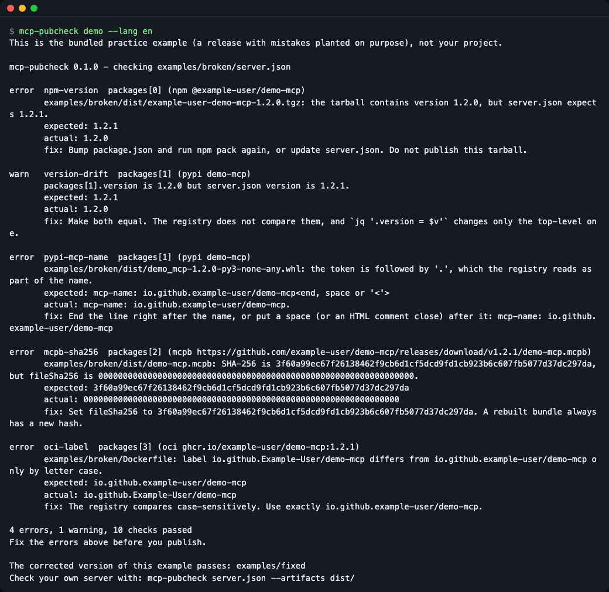
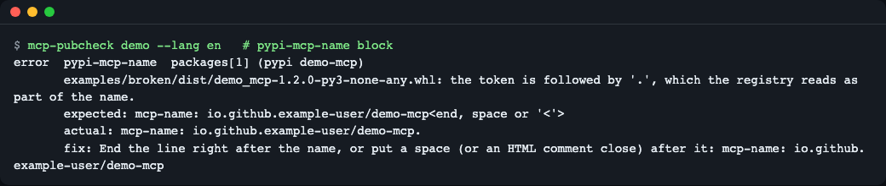
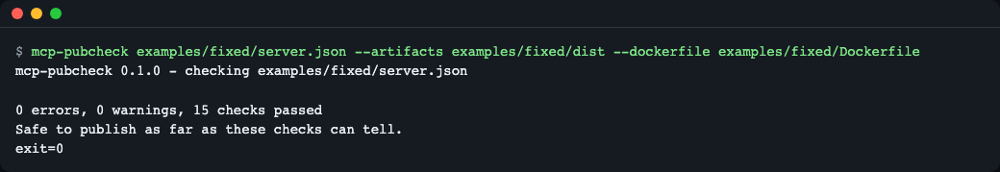
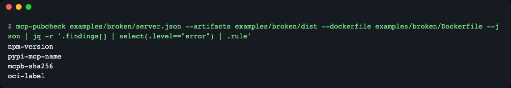
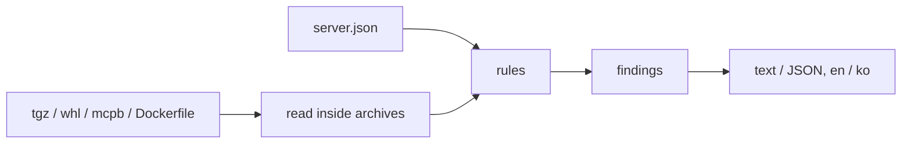

# mcp-pubcheck

**English** | [한국어](README.ko.md)

Check your MCP server's **built packages** (npm tarball, PyPI wheel, MCPB bundle, Docker label) against `server.json` *before* you publish — offline, in one command. It does not replace `mcp-publisher`; it is a gate in front of it, and it opens the files you are about to upload, not your source tree.


*The bundled practice example: a release with mistakes planted on purpose. Each finding shows the rule ID, expected value, actual value and a fix.*

## Who it is for
- You publish an MCP server to npm, PyPI, GHCR or as a `.mcpb` and register it in the official MCP Registry.
- Your CI runs `npm publish` then `mcp-publisher publish`, and you do not want to burn a version number on a metadata typo.
- You bump versions with a script (`jq '.version = $v'`) and want to know it touched every place.

## Why
npm and PyPI versions cannot be reused. The registry checks ownership markers (`mcpName`, `mcp-name:`, image label) **after** your package is already published, so a typo costs a new version. It is like checking the invoice against the box contents *before* you tape the box shut. Sources: [publishing guide](https://modelcontextprotocol.io/registry/quickstart), [registry#1525](https://github.com/modelcontextprotocol/registry/issues/1525) (checked 2026-11-17).

## Install

Needs Node.js 20 or newer (`brew install node`, or <https://nodejs.org>). On a minimal Linux image install `git` and `nodejs`/`npm` too. `jq` is optional (only for the `--json` example).

```bash
git clone https://github.com/LeeGyeongPil/mcp-pubcheck
cd mcp-pubcheck
npm ci
```

After the npm release you can run it without cloning: `npx mcp-pubcheck …` (or `npm install -D mcp-pubcheck`).

## Quick start

Try the bundled practice example (real `npm pack` / `uv build` artifacts with four mistakes planted on purpose):

```bash
npm start
```

This builds the project and checks `examples/broken/`. The output is the screenshot above; the end reads:

```text
4 errors, 1 warning, 10 checks passed
Fix the errors above before you publish.

The corrected version of this example passes: examples/fixed
Check your own server with: mcp-pubcheck server.json --artifacts dist/
```

`demo` always exits 0, because it is a lesson, not a gate. To check your own server, run this from your server's project folder (use the full path to `dist/cli.js` of this clone, or `npx mcp-pubcheck` after the npm release):

```bash
node /path/to/mcp-pubcheck/dist/cli.js server.json --artifacts dist/
```

Step by step on the practice example:

1. **Read a finding.** `npm-version` says the tarball contains 1.2.0 but `server.json` expects 1.2.1. A tarball built from an old version would have been published and rejected.
2. **See why one dot matters.** The registry reads `mcp-name: io.github.example-user/demo-mcp.` as a name ending in a period:

   
   *Expected and actual are printed side by side, with the exact fix.*
3. **Fix and re-run.** The fixed copy passes and exits 0:

   ```bash
   node dist/cli.js examples/fixed/server.json --artifacts examples/fixed/dist --dockerfile examples/fixed/Dockerfile
   ```

   
   *"Safe to publish as far as these checks can tell." — a pre-flight, not a guarantee.*

## What it checks

| Target | Rule IDs | What |
|---|---|---|
| `server.json` | `schema`, `typo-key`, `version-range`, `forbidden-field`, `registry-base-url`, `meta-keys`, `meta-size`, `namespace-owner` | Bundled schema (2025-12-11) plus what the schema cannot say: `registry_type` typos, `latest`/`^1.2`, fields forbidden per type, repo owner vs namespace |
| Version drift | `version-drift` | Top-level `version` equals each `packages[].version`. The registry does not compare them |
| npm `.tgz` | `npm-identifier`, `npm-version`, `npm-mcp-name` | `package/package.json` **inside the tarball** |
| PyPI `.whl` / sdist | `pypi-name`, `pypi-version`, `sdist-version`, `pypi-mcp-name` | `METADATA`; `mcp-name:` boundary rule; README missing from metadata |
| `.mcpb` | `mcpb-sha256`, `mcpb-url`, `mcpb-manifest` | SHA-256 vs `fileSha256` (prints the right hash). The registry does not check it |
| OCI | `oci-label`, `oci-tag` | `Dockerfile` `LABEL` or `docker inspect` JSON |

Every rule, level and fix: [docs/rules.md](docs/rules.md).

## Usage

| Option | What it does |
|---|---|
| `[server.json]` | File to check (default `./server.json`) |
| `--artifacts <dir\|file>` | Built packages (repeatable): `.tgz`, `.whl`, `.tar.gz`, `.mcpb`, `Dockerfile` |
| `--npm` `--wheel` `--sdist` `--mcpb` `--dockerfile` `--oci-inspect` | Name one file explicitly (`docker inspect IMG > inspect.json`) |
| `--repo-url <url>` | Repository URL for the namespace check (default: `server.json`, then `.git/config`) |
| `--schema <file>` | Use another copy of the `server.json` schema |
| `--json` | JSON report ([schemas/report.schema.json](schemas/report.schema.json)) |
| `--strict` | Warnings also fail |
| `--require-all` | A package without an artifact is an error, not a skipped warning |
| `--verbose`, `--no-color` | Show passed checks / turn colour off (`NO_COLOR` works too) |
| `--lang en\|ko` | Output language |

| Exit code | Meaning |
|---|---|
| 0 | No errors (warnings possible) |
| 1 | Errors; or warnings with `--strict`; or a missing artifact with `--require-all` |
| 2 | Bad usage or unreadable input (missing file, invalid JSON, corrupt or unsupported archive) |

Rule IDs and `--json` keys are the same in every language; only `message` and `fix` are translated. List the failing rules for a script:

```bash
node dist/cli.js examples/broken/server.json --artifacts examples/broken/dist --dockerfile examples/broken/Dockerfile --json | jq -r '.findings[] | select(.level=="error") | .rule'
```

```text
npm-version
pypi-mcp-name
mcpb-sha256
oci-label
```


*Same four rule IDs from `--json`, ready for CI scripts.*

### Use in CI

Put it between the build and the first publish (full job in [docs/github-actions.md](docs/github-actions.md)):

```yaml
      - run: npm ci
      - run: npm pack --pack-destination release
      - run: npx mcp-pubcheck server.json --artifacts release --require-all   # fails here, before publishing
      - run: npm publish release/*.tgz   # the exact tarball that was checked
      - run: mcp-publisher publish
```

## Language

`--lang en|ko`, then `MCP_PUBCHECK_LANG`, then `LC_ALL`, `LC_MESSAGES`, `LANG`. Anything not starting with `ko` gives English.

```bash
MCP_PUBCHECK_LANG=ko node dist/cli.js demo
```

## How it works



- It reads `server.json` and the bundled JSON Schema (copied from the registry, Apache-2.0 — see [THIRD_PARTY_NOTICES.md](THIRD_PARTY_NOTICES.md)).
- tar and zip are read by built-in code on top of Node's `zlib`: pax and GNU long names, stored and deflate entries. zip64, sparse tar and encrypted files stop the run with exit 2 instead of being skipped silently.
- Facts are extracted from the **built files** (tarball `package.json`, wheel `METADATA`, SHA-256 of the bundle, Dockerfile labels) and compared with `server.json`.
- No network access, no keys. Runs in about a second.

Limits: NuGet and Cargo packages are reported as "not checked yet"; Dockerfile `ARG`/`ENV` labels cannot be resolved offline (use `--oci-inspect`); the bundled schema is dated 2025-12-11 and the registry has the last word.

## When to use it

- Good fit: a release pipeline that builds artifacts, then publishes to npm/PyPI/GHCR, then registers in the MCP Registry.
- Not a fit: checking the live registry or versions that are already published (this tool is offline).

## Comparison

- The registry's own `mcp-publisher` validates `server.json` and publishes; it is the next step after this check ([docs](https://modelcontextprotocol.io/registry/quickstart)). Checking the live registry or already-published versions is a different job from this offline check.
- Source-manifest checkers compare `package.json`, `pyproject.toml` or `Cargo.toml` in your source tree with `server.json`. mcp-pubcheck opens the built artifacts instead (tarball, wheel, `.mcpb`, image label), so it also catches what the build changed or got wrong. `mcp-publisher validate` needs a registry server call and does not look inside artifacts.

## Troubleshooting

| Symptom | Cause | Fix |
|---|---|---|
| `skipped` warning for a package | No artifact found for it | Pass `--artifacts dist` or the explicit option; `--require-all` makes it an error |
| `ambiguous` error | Several builds of one package in `dist/` | Clean old builds or pass the exact file |
| `oci-label.unresolved` | Label uses `ARG`/`ENV` | `docker inspect IMG > inspect.json`, then `--oci-inspect inspect.json` |
| Exit 2 and "unsupported archive" | zip64, sparse tar or encrypted file | Build a plain archive |
| `mcpb-sha256` fails after every rebuild | A rebuilt bundle always has a new hash | Copy the printed hash into `fileSha256` as the last step |

## Development

```bash
npm test
```

Bugs and ideas: please open an issue. Changes: [CHANGELOG.md](CHANGELOG.md).

## License

MIT. The bundled `server.json` schema is Apache-2.0 (see [THIRD_PARTY_NOTICES.md](THIRD_PARTY_NOTICES.md)).
